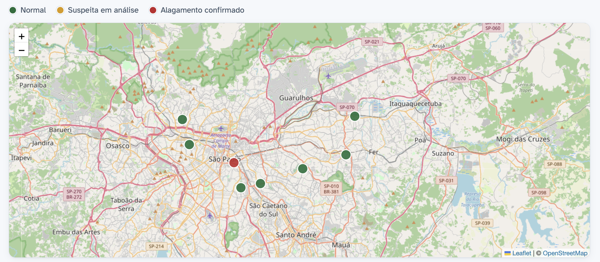
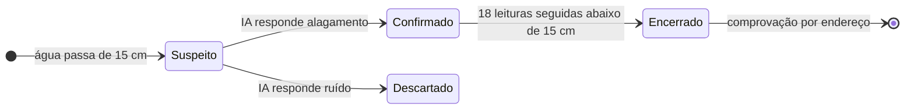
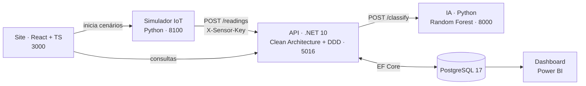
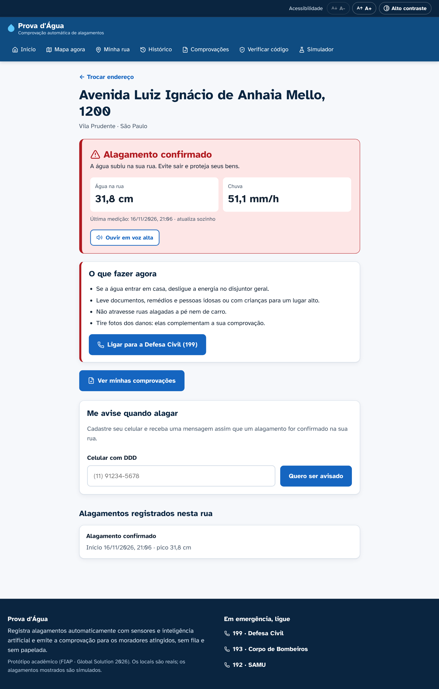
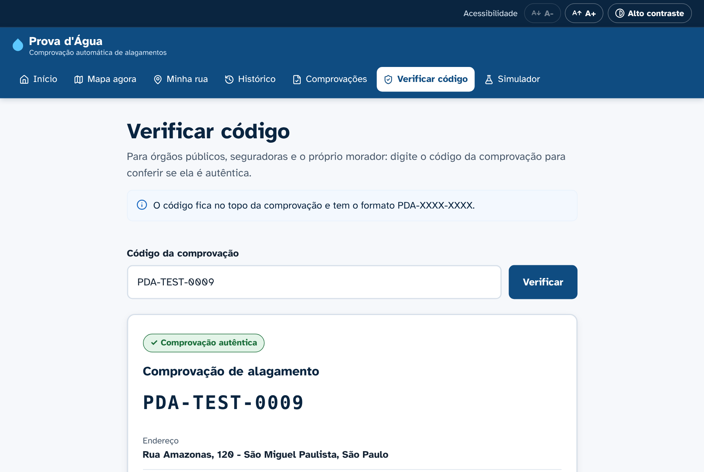

# Prova d'Água

> **Quando a água sobe, o seu direito fica registrado.**

[](https://github.com/IgornTeii/ProvaD-Agua/actions/workflows/ci.yml)

Sensores medem a água e a chuva em ruas de São Paulo que costumam alagar. Uma IA confirma quando é alagamento de verdade e descarta falsos alarmes. Quando a água baixa, cada endereço atingido recebe automaticamente uma **comprovação verificável por código**, para pedir auxílio sem fila e sem papelada.

Global Solution 2026/2 · **CitizenTech** · FIAP Engenharia de Software · ODS 11, 13 e 10

🎥 **Vídeo pitch:** [https://drive.google.com/file/d/1VVWptccEn55uDLJWgtA4pa0_qOjUAzMr/view?usp=sharing](https://drive.google.com/file/d/1VVWptccEn55uDLJWgtA4pa0_qOjUAzMr/view?usp=sharing)
📄 **PDF de entrega:** [`docs/Prova-dAgua-Entregaveis.pdf`](docs/Prova-dAgua-Entregaveis.pdf)

<p align="center">
  
</p>

---

## Rodar em 1 minuto

Pré-requisito: [Docker Desktop](https://www.docker.com/products/docker-desktop/) aberto.

```bash
git clone https://github.com/IgornTeii/ProvaD-Agua.git
cd ProvaD-Agua
docker compose up --build -d
```

Abra **http://localhost:3000** → **Simulador** → escolha uma rua → **Simular** em "Alagamento de verdade". Acompanhe o ponto ficar amarelo, depois vermelho, e veja as comprovações em **Comprovações**.

A primeira subida leva alguns minutos: as imagens são construídas, a IA é treinada dentro do build e o banco é criado automaticamente.

| Serviço | Endereço |
|---|---|
| **Site** | http://localhost:3000 |
| API (Swagger) | http://localhost:5016/swagger |
| IA | http://localhost:8000/health |
| Simulador IoT | http://localhost:8100/scenarios |
| PostgreSQL | `localhost:5432` · usuário, senha e banco: `provadagua` |

Problemas na subida? Veja [Solução de problemas](#solução-de-problemas).

---

## Onde está cada critério de avaliação

| Área | Critério | Onde ver |
|---|---|---|
| **IA e automação** | IA aplicada | [`ai/`](ai) · Random Forest que separa alagamento de ruído ([seção](#ia-e-automação)) |
| | Prompts, agentes e automação | Worker da API que consulta a IA e decide ([seção](#ia-e-automação)) · PDF, página 5 |
| | Demonstração com entrada e saída | [Exemplo de `/classify`](#demonstração-entrada--saída) |
| | Métrica antes × depois | Falsos alarmes **239 → 0** · [`ai/metrics.json`](ai/metrics.json) · resumo de cada execução do CI |
| **Big Data e visualização** | Estrutura e ingestão dos dados | [Camadas de dados](#big-data-e-visualização) · [`data/`](data) |
| | Dashboard e funções analíticas | [`dashboard/`](dashboard) · Power BI + DAX |
| **MVP, IoT e experiência** | Protótipo com 4+ telas | 7 telas no [site](#protótipo) |
| | IoT com 2+ sensores | Ultrassônico + pluviômetro em [`iot/`](iot) |
| | Fluxo funcional completo | [Do sensor à comprovação](#fluxo-funcional-completo), testado no CI |
| | Diagrama de arquitetura | [Arquitetura](#arquitetura) · PDF, página 3 |
| **DevOps, segurança e qualidade** | Módulos + Git | [Estrutura do repositório](#estrutura-do-repositório) |
| | DevOps funcionando | Docker Compose + [GitHub Actions](.github/workflows/ci.yml) com 6 jobs |
| | Segurança (2+ práticas) | [6 práticas](#segurança) |
| | Testes (5+ casos com evidência) | [81 execuções de testes](#testes) · plano com 15 casos no PDF |

---

## O problema

Soluções de enchente costumam resolver o **antes**: previsão e alerta. Quase ninguém resolve o **depois**.

No temporal de 10 de fevereiro de 2020, o CGE da Prefeitura registrou **132 pontos de alagamento** em São Paulo, 66 deles intransitáveis ([ISTOÉ, 10/02/2020](https://istoe.com.br/sp-chuva-forte-provoca-alagamento-e-interdita-marginais/)). Um deles foi a Av. Antônio Munhoz Bonilha, um dos 8 pontos monitorados neste protótipo.

Quando a água baixa, quem perdeu móveis, eletrodomésticos ou dias de trabalho precisa **provar que foi atingido** para pedir auxílio, seguro ou saque emergencial: foto, protocolo, vistoria e semanas de espera. Quem mais perdeu é quem menos pode esperar.

**Persona:** Dona Maria mora numa rua que alaga toda vez que chove forte. Com o Prova d'Água, ela digita o nome da rua, vê a comprovação do seu endereço e mostra o código ao órgão de auxílio.

## Como funciona



| Momento | O que acontece |
|---|---|
| Começa a chover | Cada leitura é gravada e nunca é apagada: é a prova |
| Água passa de 15 cm | Evento **Suspeito**; o ponto fica **amarelo** no mapa |
| A IA analisa a sequência | **Alagamento** → Confirmado, ponto **vermelho** e aviso por SMS (simulado) · **Ruído** → Descartado |
| A água baixa | Evento **Encerrado**, com o pico registrado |
| No mesmo instante | Uma **comprovação** `PDA-XXXX-XXXX` para cada endereço; elegível a auxílio se o pico chegou a 30 cm |
| Dias depois | Prefeitura, órgão de auxílio ou seguradora verificam o código |

| Participante | Papel |
|---|---|
| Cidadão | Consulta a rua, recebe o aviso e pega a comprovação |
| Defesa Civil | Define os limites e acompanha mapa, histórico e dashboard |
| Prefeitura, auxílio e seguradoras | Verificam a autenticidade pelo código |
| Sensores (IoT) | Medem nível da água e chuva a cada 10 segundos |

**ODS:** 11 (Cidades sustentáveis, meta 11.5) · 13 (Ação climática, meta 13.1) · 10 (Redução das desigualdades).

## Arquitetura



- **Serviços independentes num monorepo.** Nenhum importa código de outro: só conversam por HTTP, e cada um tem seu Dockerfile.
- **A IA opina, a API decide.** A IA só classifica uma janela de leituras. Confirmar, descartar, encerrar e emitir comprovações é regra do domínio da API, então o modelo pode ser trocado sem mexer no domínio.

| Parte | Tecnologia | Por quê |
|---|---|---|
| API | C# · ASP.NET Core .NET 10 · EF Core | Versão LTS; Clean Architecture com Result pattern |
| Banco | PostgreSQL 17 | Índices únicos e parciais garantem a idempotência |
| IA | Python · scikit-learn · Flask | Modelo explicável e mensurável, sem custo de API |
| IoT | Python, só biblioteca padrão | Mock aceito pelo regulamento; reproduz uma enchente sob demanda |
| Site | React 19 · TypeScript · Vite · Leaflet | Mapa real de São Paulo (OpenStreetMap), sem chave de API |
| Dashboard | Power BI Desktop + DAX | — |
| CI | GitHub Actions | Gratuito em repositório público |

### Estrutura do repositório

```
prova-dagua/
├── api/                  C# .NET 10
│   ├── src/
│   │   ├── ProvaDagua.Domain           regras de negócio puras
│   │   ├── ProvaDagua.Application      casos de uso e contratos
│   │   ├── ProvaDagua.Infrastructure   EF Core, PostgreSQL, cliente da IA
│   │   └── ProvaDagua.Api              controllers, chave do sensor, worker
│   └── tests/                          xUnit
├── ai/                   dataset, treino, métricas e serviço /classify   (+ tests/)
├── iot/                  sensores simulados, 6 cenários e servidor      (+ tests/)
├── web/                  site React                                     (+ tests/unit e tests/e2e)
├── data/raw/             leituras brutas geradas para o treino da IA
├── dashboard/            Power BI (.pbix), camadas de dados e prints
├── tests/smoke/          teste do sistema inteiro no Docker
├── docs/                 PDF de entrega e prints
├── .github/workflows/    CI
└── docker-compose.yml
```

## IA e automação

**Problema:** um sensor de nível não distingue um alagamento real de um carro jogando água nele. Uma regra fixa ("acima de X cm = alagou") gera falsos alarmes e, portanto, comprovações e auxílios indevidos.

**Como a IA decide:** ela recebe uma **janela de leituras**, nunca uma leitura isolada, e calcula 8 características: nível máximo e médio, oscilação, tendência, maior salto entre leituras, fração e maior sequência acima de 15 cm, e chuva média. Um Random Forest classifica em **alagamento** ou **ruído**. Com menos de 6 leituras, ou confiança abaixo de 80%, a resposta é **inconclusiva**.

**Automação:** um worker na API roda em ciclos (30 s em produção, 2 s na demonstração). Ele envia à IA as leituras de cada evento Suspeito, aplica a decisão, encerra os eventos cuja água baixou e emite as comprovações. Se a IA estiver fora do ar, nada é decidido "por garantia": o evento continua Suspeito até a próxima resposta.

### Métrica antes × depois

1.000 janelas de teste (500 alagamentos e 500 ruídos), separadas das 3.000 de treino:

| | Regra fixa (≥ 15 cm por 3 leituras) | Modelo |
|---|---|---|
| Acurácia | 75,6% | **99,9%** |
| Precisão (alagamento) | 67,4% | **100%** |
| Recall (alagamento) | 99,0% | **99,8%** |
| Falsos alarmes em 500 ruídos | 239 | **0** |
| Alagamentos perdidos em 500 | 5 | **1** |

> Métricas medidas em dados gerados pelo simulador, não em sensores de campo. O CI retreina o modelo a cada push e **falha** se acurácia, precisão ou recall ficarem abaixo de 95%, ou se o modelo deixar de ganhar da regra fixa.

### Demonstração: entrada → saída

```bash
curl -X POST http://localhost:8000/classify -H "Content-Type: application/json" -d '{"readings":[
  {"waterLevelCm":16,"rainfallMmPerHour":42},{"waterLevelCm":19,"rainfallMmPerHour":45},
  {"waterLevelCm":23,"rainfallMmPerHour":47},{"waterLevelCm":27,"rainfallMmPerHour":50},
  {"waterLevelCm":31,"rainfallMmPerHour":52},{"waterLevelCm":34,"rainfallMmPerHour":51}]}'
```

| Entrada | Saída |
|---|---|
| Água subindo junto com chuva forte (acima) | `{"label": "flood", "confidence": 1.0}` |
| Um único pico de 38 cm, sem chuva (carro jogando água) | `{"label": "noise", "confidence": 0.995}` |
| Só 3 leituras | `{"label": "inconclusive", ...}` |

Retreinar: `cd iot && python generate_dataset.py`, depois `cd ai && python train.py`. O resultado sai em `ai/metrics.json`.

## Big Data e visualização

| Camada | Conteúdo | Onde está |
|---|---|---|
| **Bruto** | Leitura exatamente como chegou do sensor; imutável | Tabela `readings` · `data/raw/training_readings.csv` |
| **Tratado** | Sem duplicatas, sem valores impossíveis, datas em UTC | Validação do domínio e índices únicos do banco |
| **Analítico** | Eventos, comprovações e agregados para o dashboard | `flood_events`, `flood_certificates`, `alert_notifications` |

**Ingestão:** sensor → `POST /readings` com a chave → validação → gravação → suspeita → IA → confirmação ou descarte → encerramento → comprovações.

### Dashboard da Defesa Civil (Power BI)

Arquivo: [`dashboard/prova-dagua.pbix`](dashboard/prova-dagua.pbix). Responde à pergunta da Defesa Civil: **"o que aconteceu na cidade?"**.

**Data lake do dashboard** (`dashboard/data`), gerado por [`dashboard/pipeline.py`](dashboard/pipeline.py) (Python, pandas):

| Camada | Conteúdo |
|---|---|
| `raw` | As 7 tabelas do PostgreSQL exportadas em CSV, sem alteração |
| `trusted` | Dados limpos: tipos corretos, datas em horário de Brasília (UTC-3), sem duplicatas, sem leituras impossíveis |
| `refined` | Modelo em estrela: `fato_eventos`, `fato_comprovacoes`, `dim_sensor`, `dim_endereco`, `dim_calendario` |

Para regenerar a trusted e a refined a partir da raw: `cd dashboard && python pipeline.py`.

**Indicadores:** alagamentos confirmados, falsos alarmes evitados pela IA e taxa de descarte, endereços atingidos e elegíveis a auxílio, tempo médio até a confirmação, duração média, pico máximo por rua e eventos por dia.
**Filtros** (sincronizados nas 4 páginas): período, zona, bairro, rua e status do evento.

| Medida DAX | O que responde |
|---|---|
| `Alagamentos Confirmados` | Quantos alagamentos reais a IA confirmou |
| `Falsos Alarmes Evitados` | Quantos eventos a IA descartou como ruído |
| `Taxa de Descarte %` | Parcela dos eventos decididos que foi falso alarme |
| `Endereços Atingidos` / `Endereços Elegíveis` | Endereços com comprovação e os que têm direito a auxílio (pico de 30 cm ou mais) |
| `Tempo Médio até Confirmação (s)` / `Duração Média (s)` | Rapidez da IA e duração dos alagamentos, em segundos |
| `Pico Máximo (cm)` | Maior nível de água nos alagamentos confirmados |
| `Confirmados Período Anterior` / `Variação vs Período Anterior %` | Comparação com o período anterior de mesma duração |

As fórmulas de todas as medidas estão no [PDF de entrega](docs/Prova-dAgua-Entregaveis.pdf). Prints das 4 páginas em [`dashboard/prints`](dashboard/prints).

Os dados do dashboard vêm do simulador do projeto e foram distribuídos entre 04 e 17/11/2026, com alguns picos ajustados, para dar variedade de datas e de elegibilidade.

## Protótipo

| Tela | O que o cidadão faz |
|---|---|
| **Início** | Entende o serviço, vê se algum ponto está alagando e escolhe o que fazer |
| **Mapa agora** | Vê os 8 pontos: verde normal, amarelo suspeita, vermelho confirmado |
| **Minha rua** | Busca o endereço, vê o gráfico da água, recebe orientações e cadastra o celular para o aviso |
| **Histórico** | Pesquisa alagamentos por data, rua ou bairro |
| **Comprovações** | Escolhe a rua e vê, imprime ou compartilha as comprovações |
| **Verificar código** | Órgão público confere se uma comprovação é autêntica |
| **Simulador** | Dispara um dos 6 cenários e acompanha cada etapa ao vivo |

<p align="center">
  
  
</p>

**Acessibilidade:** fonte Atkinson Hyperlegible (feita para baixa visão), aumentar o texto, alto contraste, "ouvir em voz alta", navegação por teclado, layout para celular e telefones de emergência (199, 193, 192) em todas as páginas.

### IoT: 2 sensores simulados

| Sensor | Equivalente real | Mede |
|---|---|---|
| Nível de água | Ultrassônico HC-SR04 a 2 m da rua | Distância até a superfície, convertida em altura da água; simula ruído e perda de eco |
| Pluviômetro | Pluviômetro de báscula | Chuva em mm/h |

A chuva é o contexto que permite à IA separar alagamento de splash. Os 8 pontos ficam em ruas reais que costumam alagar, com 3 endereços cada; as coordenadas são aproximadas e os alagamentos, simulados.

| Cenário do simulador | Resultado esperado |
|---|---|
| Alagamento de verdade · Enxurrada rápida · Alagamento sem chuva no bairro | Confirmado, encerrado e comprovações emitidas |
| Carro jogando água no sensor · Lixo parado embaixo do sensor | Suspeita aberta e descartada pela IA |
| Chuva fraca | Nada acontece |

### Fluxo funcional completo

1. No **Simulador**, "Alagamento de verdade" na Av. do Estado.
2. As leituras chegam em `POST /readings`; ao passar de 15 cm, o ponto fica amarelo.
3. A IA responde "alagamento": o ponto fica vermelho e quem cadastrou o celular recebe o aviso.
4. A água baixa: o evento é encerrado e os 3 endereços recebem a comprovação.
5. O morador vê a comprovação; um órgão público digita o código e confirma a autenticidade.

Esse fluxo, junto com o descarte de um splash, roda automaticamente no CI com todos os serviços reais ([`tests/smoke/smoke.py`](tests/smoke/smoke.py)).

### Endpoints da API

| Método | Rota | Descrição |
|---|---|---|
| `POST` | `/readings` | Ingestão de leituras (exige `X-Sensor-Key`): 202, 400 ou 401 |
| `GET` | `/sensors` · `/sensors/{id}/status` | Pontos com a situação atual |
| `GET` | `/addresses?search=` · `/addresses/{id}/notifications` | Busca de endereços e avisos enviados (telefone mascarado) |
| `POST` | `/alerts/subscriptions` | Cadastro do celular para o aviso |
| `GET` | `/flood-events` · `/flood-events/{id}` | Histórico com filtros por sensor, status, período e rua |
| `GET` | `/certificates?addressId=` ou `?floodEventId=` | Comprovações de um endereço ou de um alagamento |
| `GET` | `/certificates/{code}/verify` | Verifica a autenticidade (404 se não existe) |

## DevOps, segurança e qualidade

### DevOps

**Docker Compose** sobe os 5 serviços com healthchecks e dependências. **GitHub Actions** roda a cada push:

| Job | O que valida |
|---|---|
| API .NET | build e testes xUnit |
| IA Python | testes e quality gate do modelo, com a tabela de métricas no resumo |
| Simulador IoT | sensores, cenários e servidor |
| Site (unitários) | tipos, lint e Vitest |
| Site (navegador) | Playwright no desktop e no celular |
| Sistema completo | Docker Compose + alagamento e splash de ponta a ponta |

### Segurança

| Prática | Como foi aplicada |
|---|---|
| Autenticação do sensor | Chave por sensor em `X-Sensor-Key`; a identidade vem da chave, nunca do corpo, então uma chave vazada não forja alagamentos em outras ruas |
| Validação de entrada | O domínio recusa leituras impossíveis (0–500 cm, chuva ≥ 0, data não futura); celular com 10 ou 11 dígitos |
| Integridade e idempotência | Índices únicos contra leitura duplicada, dois eventos abertos no mesmo sensor, comprovação repetida e aviso repetido |
| Código não adivinhável | `PDA-XXXX-XXXX` com gerador criptográfico, sem caracteres ambíguos |
| Privacidade | Telefone sempre mascarado na API; fontes servidas pelo próprio site, sem enviar o IP do cidadão a terceiros |
| CORS restrito | A API só aceita chamadas de navegador vindas do próprio site |

_As chaves de sensor do repositório são de desenvolvimento. Em produção, viriam de um cofre de segredos e seriam guardadas como hash._

### Testes

| Parte | Ferramenta | Testes | Rodar |
|---|---|---|---|
| Domínio da API | xUnit | 8 | `cd api && dotnet test` |
| IA | pytest | 19 | `cd ai && pip install -r requirements-dev.txt && python -m pytest` |
| Simulador IoT | pytest | 25 | `cd iot && pip install -r requirements-dev.txt && python -m pytest` |
| Site | Vitest + Testing Library | 21 | `cd web && npm ci && npm test` |
| Site no navegador | Playwright (desktop e celular) | 4 cenários × 2 | `cd web && npx playwright install chromium && npm run test:e2e` |
| Sistema completo | `tests/smoke/smoke.py` | 1 fluxo | com o Docker no ar: `python tests/smoke/smoke.py --site http://localhost:3000` |

## Impacto

| Indicador | Hoje | Com o Prova d'Água |
|---|---|---|
| Tempo até a comprovação | Semanas | Logo depois que a água baixa |
| Quem prova o alagamento | O próprio cidadão | O sensor, automaticamente |
| Falsos alarmes (simulado) | 239 em 500 | 0 em 500 |
| Aviso ao morador | Nenhum | Mensagem quando o alagamento é confirmado |

Os limites de suspeita (15 cm) e de elegibilidade (30 cm) são parâmetros da Defesa Civil de cada município. Para outra cidade, basta instalar sensores e cadastrar os endereços cobertos.

## Limitações conhecidas

- Métricas da IA medidas em dados simulados.
- Se a IA ficar fora do ar durante todo o alagamento, o evento fica Suspeito e não gera comprovação.
- A IA analisa as leituras mais recentes do sensor, e não uma janela presa ao início do evento.
- Comprovações públicas por código, sem login (próximo passo: gov.br); o SMS é simulado.

## Solução de problemas

| Sintoma | O que fazer |
|---|---|
| `port is already allocated` | Outro programa usa a porta (3000, 5016, 8000, 8100 ou 5432). Feche-o ou troque a porta da esquerda no `docker-compose.yml` |
| Site em branco ou com versão antiga | `docker compose up --build -d web` e recarregue sem cache (Cmd+Shift+R ou Ctrl+Shift+R) |
| A API não responde logo após subir | Ela espera o banco e a IA ficarem saudáveis; aguarde alguns segundos e veja `docker compose logs api` |
| Quero começar com o banco vazio | `docker compose down -v && docker compose up --build -d` |

## Uso de IA generativa

Declaração conforme o regulamento. Todo o conteúdo gerado foi lido, entendido e revisado pelo grupo antes de entrar no projeto.

| Ferramenta | Uso |
|---|---|
| Claude (Anthropic) | Apoio na ideação, em dúvidas de arquitetura e de erros, e na geração e revisão de código e documentação |

## Integrantes

| Nome | RM |
|---|---|
| Igor Nunes Teixeira | 551099 |
| Lorenzo Guimaraes | 99621 |
| Cayo Malara | 551243 |
| Thiago Bullara | 99461 |
